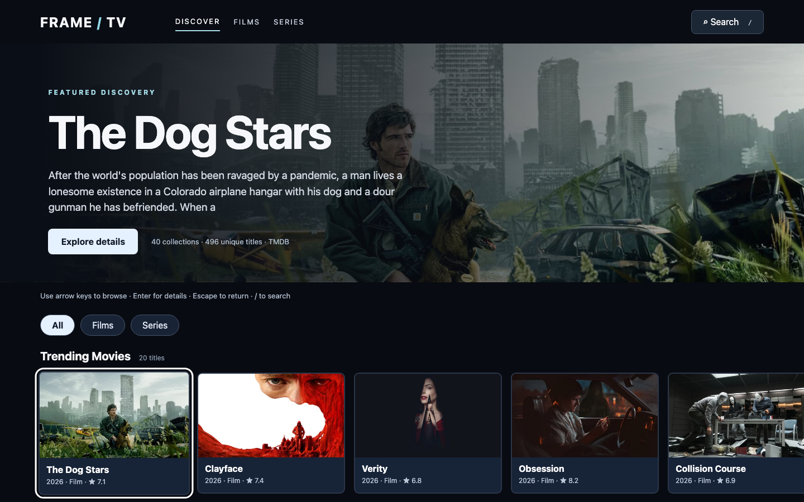

# FRAME / TV — Lean-Back Streaming Discovery

A TV-first, remote-navigable discovery interface built with **React, TypeScript, Redux Toolkit, GraphQL Yoga, Node.js, and TMDB**. This is an independent educational portfolio project, not affiliated with Netflix or TMDB.

## Preview



[Watch the interactive demo](docs/media/demo.mp4)

## Features

- Forty themed discovery rows populated from TMDB metadata (results vary over time).
- Keyboard/D-pad navigation (arrows), row focus memory, Enter to open details, Escape to close.
- Responsive cinematic hero, landscape artwork, accessible details dialog, and title search across movies and TV series.
- Official YouTube trailer lookup via TMDB's videos endpoint, embedded only after the user requests playback.
- All discovery rows remain available to mouse/trackpad scrolling; CSS content-visibility and lazy-loaded artwork reduce off-screen rendering work. This is not JavaScript row virtualization.
- Server-side TMDB access token; no secrets bundled into client JavaScript.
- GraphQL catalog, search, trailer and health queries; server cache for catalog responses.

## Setup (macOS Terminal)

Requires Node.js 22 LTS or newer, npm, and a TMDB API Read Access Token.

```bash
npm install
cp .env.example .env
nano .env # replace placeholder with your private TMDB read access token
```

In Terminal A:

```bash
npm run api
```

In Terminal B:

```bash
npm run dev
```

Open http://localhost:5173. GraphQL IDE: http://localhost:4000/graphql.

## Verify

```bash
npm run test
npm run build
```

## Controls

| Input | Behavior |
|---|---|
| Left / Right | Move focus within a shelf |
| Up / Down | Change shelf and restore last focused column (clamped to available items) |
| Enter | Open selected title |
| Escape | Close details or search |
| / or S | Open search |

## Architecture

`React UI → Vite /graphql proxy → GraphQL Yoga (Node) → TMDB API`

The browser never receives the TMDB access token. The server fetches 40 categories, caches catalog responses for 30 minutes, and resolves search and trailer requests on demand.

## Performance and test boundaries

The app uses CSS content-visibility and lazy-loaded images, but does not yet implement viewport-aware row virtualization. **No real Fire TV/Tizen performance claims are made.** CPU-throttled Chrome tests and input-to-focus latency benchmarking belong in the separate performance lab.  The number of *unique* TMDB titles is reported at runtime; 2,000+ unique titles is not guaranteed by 40 single-page categories.

## Trailer licensing

TMDB returns official trailer links when available. This demo embeds YouTube-hosted trailers on demand; it does not distribute full-length films or claim HLS/Shaka playback. Shaka Player would be appropriate only for a separately licensed HLS demo stream.

## TMDB attribution

This product uses the TMDB API but is not endorsed or certified by TMDB. Add the official TMDB logo and comply with the current TMDB attribution requirements before public deployment.

## Release validation checklist

- Run `npm ci`, `npm run test`, and `npm run build` on your machine.
- Run API and Vite in separate terminals with a private `.env` token.
- Test arrow navigation and row focus memory, click-to-open, Escape-to-close, and search.
- Check trailer playback and the no-trailer case. YouTube may block embeds for some titles.
- Test Chrome DevTools performance and memory; do not claim FPS/latency/heap targets without measurements.
- Test Fire TV/Tizen on actual devices before claiming platform compatibility.

## Current limitations


- No licensed HLS playback or Shaka Player integration is included.


## Verified Browser Tests

Five Playwright Chromium tests passed:

- Live TMDB catalog loading
- Header and category filtering
- Global search across movies and series
- Movie details opening and closing
- D-pad navigation and focus restoration

Run with the API and frontend servers active:

    npx playwright test

## Desktop Performance Measurements

| Metric | Result |
|---|---:|
| Navigation P50 | 15.6 ms |
| Navigation P95 | 40.1 ms |
| Maximum navigation latency | 44.5 ms |
| Successful navigation samples | 50/50 |
| Scrolling frame callback rate | 60.0 FPS |
| P95 frame interval | 16.7 ms |
| JavaScript heap snapshot | 57.51 MB |
| Production JavaScript (gzip) | 81.90 KB |

Measurements were collected in headless desktop Chromium.
Navigation measures synthetic key-event-to-focus latency.
Scrolling measures animation-frame callback timing, not GPU-rendered
frames. Fire TV and Tizen hardware have not been tested.
